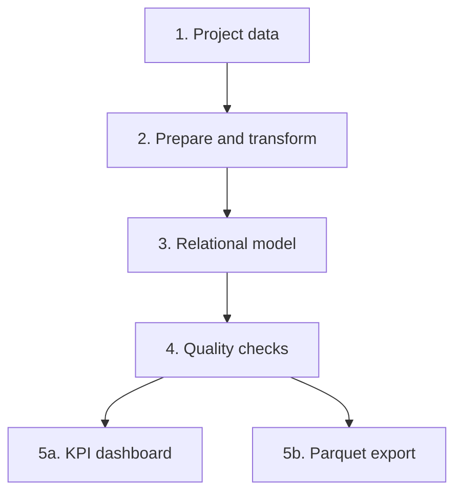

<div align="center">

# DataVita

**End-to-end data analytics product**

Data preparation, modelling, quality checks, and interactive KPI dashboards in one deliverable.

[](https://datavit.streamlit.app/)
[](https://www.python.org/)
[](https://mounir-gmamsi.netlify.app/)

</div>

---

## Overview

DataVita is a complete analytics workflow designed as a usable product, not only a notebook. It covers data preparation, relational modelling, quality validation, KPI analysis, and an interactive dashboard that stakeholders can explore.

**Demo:** [datavit.streamlit.app](https://datavit.streamlit.app/)

---

## What the product delivers

| Capability | Description |
|------------|-------------|
| Data preparation | Clean and transform source data for analysis |
| Data modelling | Relational structure for consistent reporting |
| Data quality | Validation checks before insights are published |
| KPI analytics | Metrics and views for decision support |
| Interactive UI | Streamlit dashboard for exploration |
| Export | Parquet output for downstream pipelines |

---

## Technology stack

### Languages


### Data processing and storage


### Analytics, ML and interface


| Layer | Technologies |
|-------|----------------|
| Application | Streamlit, Plotly |
| Processing | Python, Pandas, NumPy, PyArrow |
| Query / storage | SQL, PostgreSQL, SQLAlchemy, DuckDB |
| Machine learning | scikit-learn, imbalanced-learn |
| Export | Parquet |
| Configuration | python-dotenv |

---

## Solution flow

| Step | Stage | Technologies |
|:----:|-------|--------------|
| 1 | Ingest project data | Python, Pandas |
| 2 | Prepare and transform | Python, Pandas, SQL |
| 3 | Build relational model | PostgreSQL, SQLAlchemy, DuckDB |
| 4 | Run quality checks | Validation logic in Python |
| 5a | Present KPI dashboard | Streamlit, Plotly |
| 5b | Export for downstream use | Parquet, PyArrow |



---

## Repository structure

| File / folder | Purpose |
|---------------|---------|
| `DataVita_V2.py` | Main Streamlit application |
| `export_to_parquet.py` | Parquet export utility |
| `data/` | Project data assets |
| `requirements.txt` | Python dependencies |

---

## Run locally

```bash
python -m venv .venv
.venv\Scripts\activate
pip install -r requirements.txt
streamlit run DataVita_V2.py
```

On macOS or Linux, activate with `source .venv/bin/activate`.

---

## Author

**Mounir Gmamsi**  
[Portfolio](https://mounir-gmamsi.netlify.app/) · [GitHub](https://github.com/Mr-Gms-33) · [LinkedIn](https://www.linkedin.com/in/mounir-gmamsi-1595951b3)
